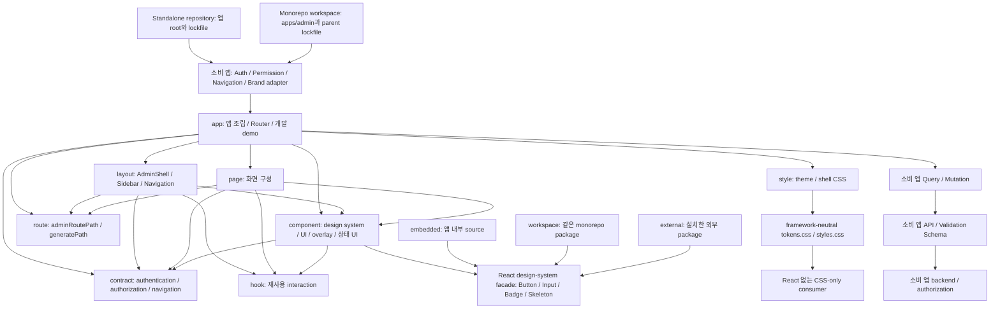

# dix-admin-template

여러 프로젝트에서 같은 구조로 Admin을 시작하는 React 19 source template입니다. 공통 shell, 탐색, form·table·overlay와 interaction Hook을 제공하며, 제품의 Business Logic(비즈니스 로직)·API·인증 구현은 소비 프로젝트가 연결합니다.

## 시작하기

Node.js `>=20.19.0`, npm `>=10.8.0`을 사용합니다.

```sh
npm ci
npm run dev
```

개발 서버가 출력하는 주소를 열고 **Demo 로그인**을 선택합니다. 예제 데이터와 세션은 브라우저 메모리에만 있으며 새로고침하면 초기화됩니다. 목록의 loading·empty·error와 form의 pending·error·success를 확인할 수 있습니다.

Production은 [App](src/app/App.tsx)의 `consumer`에 실제 앱을 주입해야 합니다. 기본 `npm run build`는 성공하지만 consumer가 없으면 설정 오류 화면을 출력합니다. 개발 demo는 production bundle에 포함되지 않습니다. 연결 예제와 설치 명령은 [소비 프로젝트 안내](.agents/references/consumer-guide.md)를 따릅니다.

## 아키텍처

아래 그림은 역할별 source 구성과 소비 프로젝트의 데이터 흐름을 나타냅니다. Template은 여러 프로젝트에서 반복되는 앱 조립·화면 기반을 제공하고, 제품별 기능과 API·Query·Mutation은 소비 프로젝트가 소유합니다.



`app`은 화면과 공통 기반을 조립합니다. 역할 폴더를 제품 도메인 확장 위치로 사용하지 않으며, 제품 기능과 Domain model은 소비 앱의 기존 architecture 안에 둡니다.

## 소비 방식

| 선택                    | 책임                                                                                                                                                                 |
| ----------------------- | -------------------------------------------------------------------------------------------------------------------------------------------------------------------- |
| Standalone repository   | 앱 root의 `package.json`·`package-lock.json`·`node_modules`로 설치하고 실행합니다.                                                                                   |
| Monorepo workspace      | 앱 source를 `apps/admin`에 두고 parent workspace가 dependency·lockfile을 관리합니다. [검증 fixture](fixtures/consumer-monorepo/package.json)가 이 구성을 보여줍니다. |
| Embedded design system  | 기본 primitive source를 앱 안에서 수정합니다.                                                                                                                        |
| Workspace design system | 같은 monorepo package의 component를 `DesignSystemProvider`에 전달합니다.                                                                                             |
| External design system  | 설치한 package의 component를 같은 provider contract에 맞춰 전달하고 해당 CSS를 import합니다.                                                                         |

Provider 교체 범위는 `Button`, `Input`, `Badge`, `Skeleton`입니다. 고수준 Admin UI와 overlay는 template source에서 확장합니다. React component는 React 19가 필요하며, [tokens.css](src/component/design-system/tokens.css)와 [styles.css](src/component/design-system/styles.css)는 JavaScript 없이 소비할 수 있는 별도 CSS entry입니다. 이 repository는 npm에 publish된 UI package가 아닙니다.

## 라우팅과 제품 기능

[경로 객체](src/route/route-paths.ts)는 app-local path와 `generatePath` builder를 소유합니다. [Router](src/app/route/router.tsx)는 실제 `Route`·element·handle을 명시적으로 등록합니다. 기본 basename은 `/`이며 배포 mount 경로는 router option으로 분리합니다. 메뉴, redirect, breadcrumb, title은 같은 path API를 사용합니다.

인증 상태는 `loading | anonymous | authenticated | error`, permission은 capability 기반입니다. 등록되지 않은 capability는 거부합니다. 메뉴 표시와 route guard는 UI 동작이며 서버의 authorization(권한 판정)을 대체하지 않습니다.

## 개발 문서와 검증

- [디자인 기준](DESIGN.md): 기본 token, shell·반응형 규칙, 공통 UI·Skeleton·overlay 계약
- [Frontend 아키텍처](.agents/references/frontend-architecture.md): 실제 source 지도, 역할 의존, route·provider 확장 계약
- [도구 명세](.agents/references/spec.md): manifest 범위, lockfile 버전, 환경과 명령
- [소비 프로젝트 안내](.agents/references/consumer-guide.md): setup, adapter, 제품 기능과 데이터 연결
- [Project-local Agent Kit 설치](.agents/references/agent-kit-installation.md): Skills CLI와 consumer-local reference·AGENTS 갱신
- [에이전트 작업 지도](AGENTS.md): 작업별 reference와 project-local Skill 선택

```sh
npm run typecheck
npm test -- --run
npm run build
npm run verify:template-layout
npm run verify:template-contracts
npm run verify:template-domain-boundary
npm run verify:template-architecture
npm run verify:template-routes
npm run verify:design-system-modes
npm run verify:consumer-modes
npm run verify:consumer-docs
npm run verify:agent-docs
npm run verify:skills
npm run verify:agent-kit-install
```

[quality workflow](.github/workflows/quality.yml)는 source·동작·build·provider·consumer·문서·Skill·Agent Kit 계약을 검사합니다. 브라우저 화면·keyboard·focus·실제 network 요청은 별도의 브라우저 검증 증거로 확인합니다.
