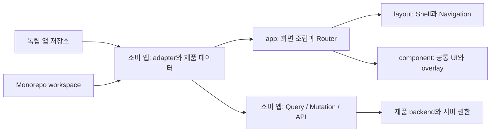

# dix-admin-template

여러 프로젝트에서 공통 어드민 화면을 시작할 수 있는 React 19 source template입니다. Shell, navigation, 디자인 primitive, form/table/상태 UI, modal·toast와 interaction Hook을 제공합니다. 제품별 계정, 권한 체계, 기능, 데이터 API는 소비 프로젝트가 연결합니다.

## 시작하기

Node.js `>=20.19.0`, npm `>=10.8.0` 환경에서 실행합니다.

```sh
npm ci
npm run dev
```

개발 서버의 주소에서 demo 로그인과 예제 화면을 확인합니다. 사이드바의 `공통 컴포넌트`(`/component`)에서 기본 UI, 입력·선택, 비동기 상태, 표, Modal·Toast를 직접 조작할 수 있습니다. 예제 session·data는 브라우저 memory에만 있으며 새로고침하면 초기화됩니다. Production은 [`src/app/App.tsx`](src/app/App.tsx)의 consumer adapter를 연결해야 합니다. Adapter가 없으면 설정 오류 화면이 표시되고 demo는 production bundle에 포함되지 않습니다. 자세한 조립은 [소비 프로젝트 안내](.agents/references/consumer-guide.md)를 확인합니다.

## Source 구조와 데이터 경계

Source는 역할에 따라 책임을 둡니다. 제품 기능과 Domain은 소비 프로젝트가 소유합니다.



`src/app`은 `page`, `layout`, `component`, `contract`, `hook`, `route`, `style`을 조립합니다. `src/component/ui`에 primitive와 모든 공통 UI를 둡니다. 제품 기능, 제품 Domain model, API 응답과 business rule을 새 역할에 추가하지 않습니다. Source 역할·의존 규칙은 [Frontend 아키텍처](.agents/references/frontend-architecture.md)에 있습니다.

## 디자인·스타일

[`DESIGN.md`](DESIGN.md)는 현재 구현을 기준으로 색상·타이포그래피·간격·responsive shell·공통 컴포넌트 API를 정리합니다. Tailwind CSS 4를 사용하며 [`src/style/tailwind.css`](src/style/tailwind.css)가 유일한 CSS 진입점입니다. 컴포넌트별 CSS 파일을 두지 않고 표현은 각 source의 Tailwind class로 작성합니다.

실제 공통 컴포넌트에는 `Button`, `Input`, `Badge`, `Skeleton`, `FormField`, `Combobox`, `ChipInput`, `RemovableChip`, `SegmentedControl`, `Dropzone`, `PendingButton`, `AsyncState`, `DataTable`, `DetailList`, `StatCard`, `Breadcrumb`, `Modal`, `Toast`, `Shell`, `Sidebar`, `Navigation`이 있습니다. [`DemoComponentPage`](src/page/demo/DemoComponentPage.tsx)에서 동작 예시를 확인하고 각 계약은 [디자인 시스템 문서](DESIGN.md)에서 확인합니다.

Demo Sidebar에는 교체용 예시 로고가 표시됩니다. 소비 프로젝트는 `Brand.logo`에 프로젝트 SVG/React component를 전달하고, 메뉴만 추가할 때는 `NavigationItem`을 추가합니다. 새 화면과 새 URL이 필요하면 `routePath`, `RouteElementMap`, `createRouteList`, `routeHandle`, 소비 앱의 `navigationList`를 함께 연결합니다. 자세한 코드는 [소비 프로젝트 안내](.agents/references/consumer-guide.md)를 확인합니다.

## 소비·라우팅 계약

| 구성                                 | 책임                                                                                                                                                                              |
| ------------------------------------ | --------------------------------------------------------------------------------------------------------------------------------------------------------------------------------- |
| Standalone                           | app root에서 dependency와 lockfile을 관리합니다.                                                                                                                                  |
| Monorepo workspace                   | parent가 dependency·lockfile을 관리하고 앱은 `apps/admin` 아래 둘 수 있습니다. 검증 구성은 [`fixtures/consumer-monorepo/`](fixtures/consumer-monorepo/package.json)을 참고합니다. |
| `DesignSystemProvider`               | `Button`, `Input`, `Badge`, `Skeleton` 네 primitive의 embedded/workspace/external 구현을 선택합니다. 다른 공통 UI는 `component/ui`의 template source입니다.                       |
| Authentication/authorization adapter | 소비 앱의 로그인 상태·capability 판단 결과를 template에 연결합니다. 실제 session과 서버 권한은 제품 구현입니다.                                                                   |
| Route                                | [`route-paths.ts`](src/route/route-paths.ts)의 app-local path를 [`router.tsx`](src/app/route/router.tsx)에서 명시적으로 등록합니다. mount 경로는 basename으로 분리합니다.         |

역할·모듈을 건너는 import는 `@/component/ui/Button`처럼 구체 파일을 지정합니다. `index.ts` barrel은 두지 않습니다. `@/*`는 `src/*`에 연결되며 Vite·TypeScript·Vitest가 같은 alias를 사용합니다.

## 개발 문서와 검증 명령

- [디자인 시스템](DESIGN.md): 정확한 token과 실제 공통 component 사용 계약
- [Frontend 아키텍처](.agents/references/frontend-architecture.md): 역할 경계, route와 adapter
- [도구 명세](.agents/references/spec.md): dependency·script·환경과 검증 범위
- [소비 프로젝트 안내](.agents/references/consumer-guide.md): standalone/workspace setup과 adapter 구성
- [에이전트 작업 지도](AGENTS.md): 작업별 reference와 project-local Skill

변경 대상에 맞춰 `npm run typecheck`, `npm run build`, `npm run verify:template-layout`, `npm run verify:template-contracts`, `npm run verify:template-domain-boundary`, `npm run verify:template-architecture`, `npm run verify:template-routes`, `npm run verify:design-system-modes`, `npm run verify:consumer-modes`, `npm run verify:consumer-docs`, `npm run verify:agent-docs`, `npm run verify:skills`, `npm run verify:agent-kit-install`을 사용합니다. 테스트는 `npm test -- --run`으로 실행합니다. Hosted CI·브라우저 시각 검증 결과는 로컬 build와 구분합니다.
